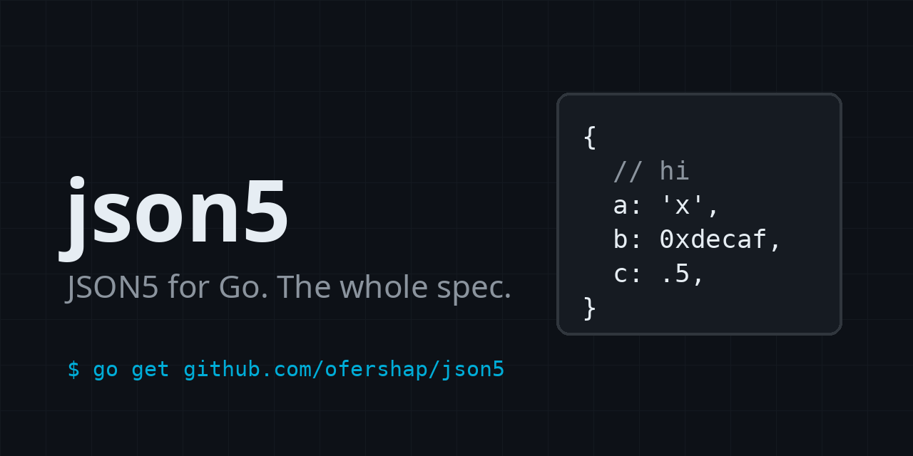

# json5



**Your config has comments and trailing commas. Go's JSON package won't read it.**

`encoding/json` rejects every JSON5 file by design, and the Go ports that do exist stopped years ago - the most-starred one fails 53 of the 83 files in the official JSON5 test corpus, including every block comment and single-quoted string. So your hand-editable config, your LLM's almost-JSON output, your fixture files - none of them parse.

json5 is a spec-true JSON5 parser and encoder for Go with the `encoding/json` API you already know.

```go
var cfg Config
err := json5.Unmarshal([]byte(`{
    // tune the worker pool
    workers: 0x10,        // hex is fine
    timeout: .5,          // so is a leading dot
    tags: ['fast', 'cheap',],
}`), &cfg)
```

## Install

```sh
go get github.com/ofershap/json5
```

Standard library only. No dependencies.

## What it does

- **Parses the full JSON5 spec**: comments (line and block), single-quoted strings, unquoted and Unicode identifier keys, hex / leading-dot / trailing-dot numbers, `NaN` and `Infinity`, trailing commas, multi-line strings, every escape form.
- **Drops in for `encoding/json`**: `Unmarshal`, `Marshal`, `MarshalIndent`, `Valid`, `Decoder`, `Encoder`, and `json` struct tags behave the way you expect. `Decoder.UseNumber()` preserves big integers.
- **Marshals strict JSON by default**, so output interoperates everywhere. `MarshalStyled` opts into JSON5 style: indentation, single quotes, unquoted keys, trailing commas.
- **Streams**: `Decoder` reads multiple documents from one stream; errors carry line, column and byte offset.
- **Round-trips NaN and Infinity** to their JSON5 literals instead of erroring like `encoding/json`.

## What it doesn't do

- **Comment preservation**: comments are parsed and skipped, not kept for re-emission. Round-tripping a file loses its comments.
- **No leniency flags**: parsing is spec-strict. An LLM's `{"a": 1}` output is already valid JSON5; output with markdown fences or prose around it is a job for your extractor, not this parser.
- **NaN/Infinity into typed structs** via `Unmarshal` errors by design; decode into `float64` or `any` fields when you expect them.

## Verified, not vibes

Every compliance claim below runs in CI on every push:

- **Official test corpus**: 83/83 valid files from [json5/json5-tests](https://github.com/json5/json5-tests) parse to the exact values the reference implementation (`json5` on npm) computes, and 7/7 invalid inputs are rejected. The corpus is vendored under `testdata/` (MIT, attribution included).
- **Differential testing**: 512 generated documents - random structures, comment injections, edge numbers, Unicode strings - parse to identical accept/reject decisions and identical values as the reference implementation. 0 mismatches.
- **Fuzzed**: the fuzz seed corpus plus 860k+ generated inputs without a panic.

The gap this fills is measurable: running the same corpus against `github.com/yosuke-furukawa/json5` v0.1.1 (the most-starred Go port, last touched 2023) passes 30 of the 83 valid files. Comments, single-quoted strings and form-feed whitespace all fail there ([open issues](https://github.com/yosuke-furukawa/json5/issues)).

## Performance

JSON5 is a config format; correctness comes first. A realistic config document parses in ~6.5µs on a laptop (see `bench_test.go`). If you benchmark a hot path, open an issue with numbers.

## Questions engineers and agents actually ask

<details><summary><b>How do I parse JSON5 in Go?</b></summary>
<code>go get github.com/ofershap/json5</code>, then <code>json5.Unmarshal(data, &v)</code> exactly like <code>encoding/json</code>, including struct tags. Use <code>json5.NewDecoder(r)</code> for streams and <code>UseNumber()</code> to keep big integers exact.</details>

<details><summary><b>What is the difference between JSON and JSON5?</b></summary>
JSON5 is a superset of JSON that allows comments, single-quoted strings, unquoted object keys, trailing commas, hex and leading/trailing-dot numbers, <code>NaN</code>/<code>Infinity</code>, and multi-line strings. Every valid JSON document is valid JSON5, so this parser reads plain JSON too.</details>

<details><summary><b>Can Go's encoding/json read JSON5?</b></summary>
No. <code>encoding/json</code> implements RFC 8259 strictly and rejects comments, single quotes, unquoted keys and trailing commas by design. You need a JSON5-specific parser like this one.</details>

<details><summary><b>Is json5-go / yosuke-furukawa/json5 maintained?</b></summary>
As of November 2026, no Go JSON5 port with a passing spec corpus is maintained: yosuke-furukawa/json5 (158 stars) was last released in 2023 and fails most of the official corpus; titanous/json5 and json5/json5-go are older and unmaintained. This repository runs the full official corpus in CI so the claim stays checkable.</details>

<details><summary><b>Can I use JSON5 for config files in Go?</b></summary>
Yes - that is the primary use case. Write configs with comments and trailing commas, decode into structs with <code>json</code> tags, and marshal back to strict JSON with <code>json5.Marshal</code> when another tool needs plain JSON.</details>

<details><summary><b>Does it handle LLM output that is "almost JSON"?</b></summary>
Often: comments, trailing commas, single quotes and unquoted keys are exactly the ways LLM output deviates from strict JSON, and those are all legal JSON5. It will not strip markdown fences or surrounding prose - extract the document first.</details>

## Contributing

Issues and PRs welcome - see [CONTRIBUTING.md](CONTRIBUTING.md). Please report security issues privately per [SECURITY.md](SECURITY.md).
---

More projects: [gitshow](https://github.com/ofershap/gitshow) · [real-browser-mcp](https://github.com/ofershap/real-browser-mcp) · [cursor-usage-tracker](https://github.com/ofershap/cursor-usage-tracker) · [mcp-server-markdown](https://github.com/ofershap/mcp-server-markdown) · [readme-builder](https://github.com/ofershap/readme-builder) · [grok-bot-skills](https://github.com/ofershap/grok-bot-skills) · [mashov-parent-brief](https://github.com/ofershap/mashov-parent-brief) · [gailwind](https://github.com/ofershap/gailwind) · [lather](https://github.com/ofershap/lather)

---

## Author

[](https://gitshow.dev/ofershap)

[](https://linkedin.com/in/ofershap)
[](https://github.com/ofershap)
[](https://ofershap.github.io/)

---

<sub>README built with [README Builder](https://ofershap.github.io/readme-builder/)</sub>

## License

[MIT](LICENSE) &copy; [Ofer Shapira](https://github.com/ofershap)
